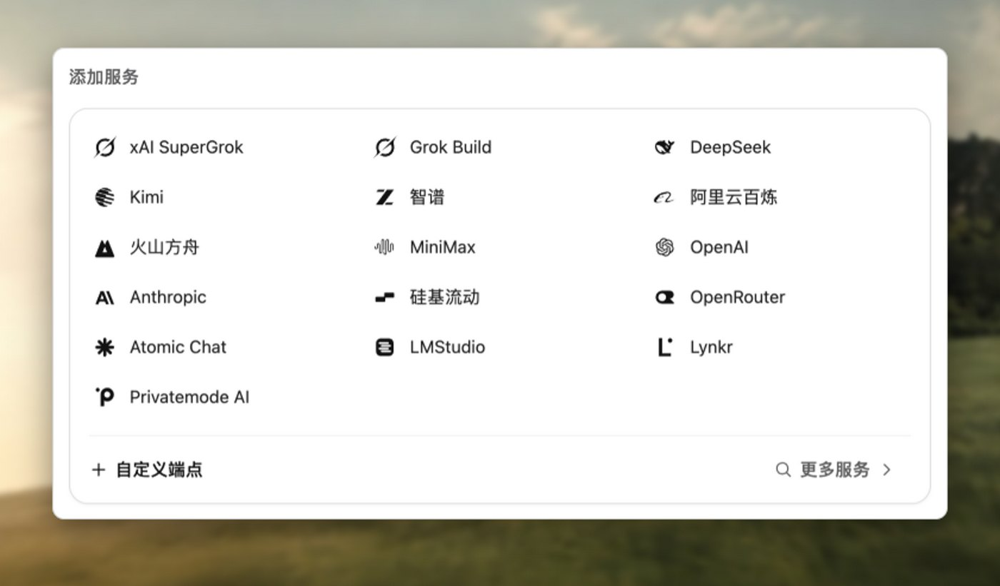

# 连接模型服务

模型服务（provider）决定 Wuu 向哪里发送请求、使用什么凭据。模型（model）则是该服务接受的模型标识。同一服务可以保存多个模型，无需重复填写连接设置。

本页设置适用于 **Wuu** 引擎。选择 Codex、Claude Code、Devin 等[外部引擎](external-engines.md)时，运行的是对应程序，使用它自身的认证和配置。在 Wuu 服务中复用订阅凭据，与运行对应的外部引擎，是两种不同的用法。



<p class="docs-caption">新增服务时选择 API 类型，再填写服务标识、模型和凭据。</p>

## 在桌面应用中添加服务

1. 打开**设置 → 模型接入 → 新增服务**。
2. 按服务支持的 API 选择类型，例如 **OpenAI 兼容**或 **Anthropic 兼容**。
3. 填写服务标识、账号可用的模型 ID、API 端点和凭据。服务要求 `/v1` 等前缀时，应一并填入端点。
4. 保存后回到输入框，选择本次对话使用的服务和模型。
5. 发送一个包含工具调用的小请求，例如读取项目文件，确认它不只是能回复文字。

首次设置会一起列出检测到的本机 Codex 和 Grok 登录。选择其中一个，即可接入并设为默认模型服务，也可以连接其他服务。已有连接不会隐藏这些选项。更多模型选项可在设置中调整。配置里列出的模型不代表你的账号一定有访问权限。

输入框中的选择属于当前对话；第一条消息发出前，它属于当前草稿。设置中还可以保存工作区默认值，切换一次对话的模型不会自动替换这些默认值。

Anthropic 兼容连接优先使用配置中明确指定的凭据或其命名环境变量，其次使用
已保存的凭据。选定这些来源后，请求不会额外附带环境中无关的 API key 或 bearer
token；明确配置两种请求头仍受支持。在设置中保存新的 API key 会替换旧 bearer
token，并删除旧 token 对应的环境变量引用。

## 管理服务和模型

在**设置 → 外部连接**中打开已连接的服务。**添加模型**可直接输入模型 ID，无需重复添加服务或凭据。模型行的垃圾桶图标会从此服务的可选项中删除该模型。删除当前选中的模型前，需要明确选择替代模型；只有一个模型时，请先添加另一个。

删除后的模型不会因重新加载或刷新目录而恢复，可在**已删除的模型**中手动恢复。已有对话、模型角色和别名保留原来的模型选择及元数据；删除可选项不会撤销模型访问权限，也不会清除对话记录。

使用服务的 **… → 删除服务**可删除整个连接及其专用密钥，共享的订阅登录会保留。删除默认服务前，需要选择另一个默认服务。已有对话会保留，使用已删除服务的对话会在下次发送时改用当前默认服务。引用该服务的模型角色恢复继承默认值，别名会被移除。删除最后一个已配置服务前，请先添加另一个。自动发现的服务和旧 Codex OAuth 连接不能在此删除，认证仍由原来的登录流程管理。

## 当前 OpenAI 和 Anthropic 模型

目录已包含 `gpt-6.1-sol`、`gpt-6-sol`、`gpt-6-luna`、`claude-opus-5-5` 和 `claude-fable-5-1`。已有会话和工作区选择保持不变，需要使用时主动切换模型。

GPT-6.1 Sol 支持 `low`、`medium`（默认）、`high`、`xhigh` 和 `max`，不支持 `none` 或 `minimal`。工具调用必须使用 Responses；官方 OpenAI 连接未明确指定协议时，Wuu 自动选择 Responses。明确指定的协议和自定义端点协议保持不变，使用工具前请选 Responses。Fast 条目通过优先处理请求同一个 `gpt-6.1-sol` 模型，API 价格为标准模式的两倍，欧盟数据驻留不支持 Fast。标准模式缓存读取为每百万 token 0.10 美元，输入超过 272K token 时费率提高。详见官方 [GPT-6.1 Sol 规格](https://developers.openai.com/api/docs/models/gpt-6.1-sol)。

通过已有 Codex 订阅使用 GPT-6.1 Sol 时，复用本机 Codex 登录并刷新订阅模型列表。账号返回基础模型后，Wuu 才会为其添加 Fast 别名；API 目录收录不代表账号拥有订阅访问权限。订阅请求继续使用 Codex 认证和订阅上下文预算策略，不要求 OpenAI API key，也不直接套用 API 输入上限。API 价格不是订阅额度估算。外部 Codex 引擎仍使用自身的模型发现和登录机制。

GPT-6 Sol 和 Luna 支持 `none` 至 `max` 推理档位，默认 `medium`。Fast 条目使用同一个模型，通过优先处理提供不同速度和价格。对这两个模型，官方 OpenAI 连接未指定协议时，Wuu 默认使用 Responses。如果明确选择了 Chat Completions，使用推理和工具时请切换为 Responses；Chat Completions 仅在 `none` 档位支持它们的工具调用。自定义端点保留原有协议。详见官方 [Sol](https://developers.openai.com/api/docs/models/gpt-6-sol) 和 [Luna](https://developers.openai.com/api/docs/models/gpt-6-luna) 规格。

Claude Opus 5.5 和 Fable 5.1 始终使用自适应思考。Wuu 将已保存的 `none` 选择映射为 `low`，两者默认档位分别为 `medium` 和 `high`。Wuu 请求可读的思考摘要，并允许 API 丢弃因上下文变更而失效的思考块，同时保留有效的签名块。这两个模型不接受强制工具选择，因此 Wuu 通过指令表达收尾工具调用要求，使用自动工具选择；这不保证模型一定调用工具。详见官方 [Opus 5.5](https://platform.claude.com/docs/en/models/opus-5-5/migration-guide) 和 [Fable 5.1](https://platform.claude.com/docs/en/models/fable-5-1/migration-guide) 迁移指南。

## DeepSeek 模型

使用 `deepseek-flash` 调用 DeepSeek V4.1 Flash 1017，或使用 `deepseek-v4-pro` 调用 V4 Pro。官方基础地址为 `https://api.deepseek.com`，Wuu 默认使用 Responses；Anthropic 兼容连接使用 `https://api.deepseek.com/anthropic`。两者均支持 1M 上下文、最多 393,216 token 输出，以及 `none`、`low`、`high`（默认）、`max` 思考档位。Flash 还支持图片输入。

目录不再推荐已下线的 `deepseek-v4-flash` 和 `deepseek-v4-flash-vision-exp`。已有选择使用这两个仍被官方接受的别名时，保留 Flash 能力并解析到最新 `deepseek-flash`；明确配置过的模型选项会保留，直到手动删除。官方目录不再提供已停用的 `deepseek-chat`、`deepseek-reasoner`，保存过这些选择时请改用 `deepseek-flash`。V4 Pro 仍可使用。

DeepSeek 的 Chat Completions 思考模式不接受强制工具选择。Wuu 对这些思考档位使用自动工具选择，`none` 档仍支持强制工具调用。思考模式忽略 temperature；Flash 的 `top_p` 仅在思考模式生效，有效范围为 0.95–1.0，非思考模式固定为 1.0。

目录按**高峰时段美元价格／百万 token**记录：Flash 输入 $0.30、缓存命中 $0.006、输出 $1.20；Pro 输入 $1.32、缓存命中 $0.044、输出 $3.96。空闲时段半价。高峰为北京时间周一至周五 09:00–12:00、14:00–18:00，中国法定节假日除外。这些静态目录价格不计算随时段变化的实际账单。详见官方[模型更新](https://api-docs.deepseek.com/zh-cn/updates)、[接口参数](https://api-docs.deepseek.com/zh-cn/api/create-chat-completion)和[价格说明](https://api-docs.deepseek.com/zh-cn/quick_start/pricing)。

## 使用 ChatGPT 登录

打开**设置 → 模型接入 → ChatGPT → 使用 ChatGPT 继续**。Wuu 在系统浏览器中打开 OpenAI 官方授权页，并通过本机回调完成登录，无需安装 Codex CLI。选择账号并明确同意 ChatGPT 套餐使用权限后，Wuu 只显示该账号实时返回的可用模型；选择模型后再连接。添加连接不会自动替换已有工作区默认模型。

每个账号注册单独保存，API key 连接、ChatGPT 登录和**本机 Codex 凭据**是不同接入方式。已有 Codex 连接继续使用原有凭据来源，不会自动迁移。原生 Codex Agent 仍由 Codex 自己管理认证。

Wuu 使用系统 Keychain 保存 OAuth 凭据，并在过期前刷新。当前安全存储实现需要 macOS；其他系统会明确提示不可用，不会静默降级为明文文件。令牌不会传给界面或写入普通配置。关闭登录对话框会取消等待中的登录。

在连接详情的**账号与用量**中可重新登录或退出。权限未启用时，使用明确的重新授权操作启用；账号过期或撤销时需要重新登录。退出会立即停止本进程的账号请求，并通知其他本机项目停止旧会话；保留注册信息以便以后重新登录。若远端撤销未确认，界面会提示到 ChatGPT 设置中断开该应用。

ChatGPT 登录仅使用公开 Responses API，流式传输且不在服务端保存响应，完整对话上下文随请求发送。可用模型来自当前账号，不复用 API key 目录或旧 Codex 目录，也不把 API 价格当作套餐额度。此连接当前不提供独立的远端套餐额度读数；界面保留未知状态，不使用旧 Codex 的额度接口。

参考官方[注册和登录说明](https://developers.openai.com/siwc/token-sharing-open-source/sign-in)及[预览限制](https://developers.openai.com/siwc/token-sharing-open-source/preview-limitations)。

## 使用已有订阅

| 连接方式 | 设置方法 |
|---|---|
| 本机 Codex 凭据 | 在模型接入中选择对应方式，明确同意复用已有的文件形式 Codex 登录。Wuu 不启动 CLI 登录或改变其存储设置；仅钥匙串存储的 Codex 登录请使用原生 Codex Agent。 |
| xAI SuperGrok | 添加 **xAI SuperGrok** 服务，按提示在浏览器登录。CLI 使用 `wuu login xai`，运行时选择 `--provider xai-subscription`。 |
| Grok Build | 在桌面端“设置 → 外部连接 → Grok Build”点击**登录**。Wuu 调用已安装的 Grok CLI 执行 `grok --no-auto-update login --oauth`，显示进度、取消和完成状态；在 CLI 打开的浏览器中完成授权。不会自动安装 CLI。凭据文件由 CLI 管理，Wuu 只复用、不复制令牌。网页或手机端请在电脑上登录后重新打开连接页面。也可自行运行 `grok login` 后选择检测到的服务，或传入 `--provider grok-build`。 |

SuperGrok 订阅登录、Grok CLI 登录和 `XAI_API_KEY` 是不同的凭据来源，请选择与你的账号对应的连接。文件编辑和命令执行还要求服务及模型支持工具调用。

### 登录方式与来源

ChatGPT 提供**登录账号**（OpenAI 官方 SIWC 授权给 Wuu）和**使用本机登录**（已有的文件型 Codex 登录）。两种方式保留独立连接；切换查看方式不会更改默认模型，也不会把账号复制到另一凭据库。已有 Wuu SIWC 账号可直接选择，不必重复登录。目前安全 SIWC 存储支持 macOS，其他主机不降级为明文或 Codex 身份。

Grok Build 提供由已安装 Grok CLI 打开浏览器登录，以及检查已有本机鉴权，两者都由 CLI 管理。外部引擎复用自身配置；本机登录操作只重新检查，不导入令牌。只有引擎提供可调用的认证方式才显示实际登录入口。Claude、Codex、OpenCode 当前使用其原生设置说明；DSH 没有 ACP 账号登录方法，Hermes/Pi 的终端设置也不是 Wuu 可调用的登录流程。

Anthropic 允许通过未修改的 Claude Code 登录，但不允许第三方中转 Claude.ai 令牌，参见[官方认证政策](https://code.claude.com/docs/en/legal-and-compliance#authentication-and-credential-use)。[DSH ACP 协议](https://github.com/deepseek-ai/deepseek-harness/blob/master/packages/acp/acp/README.md#protocol-contract)不代表服务账号登录。没有支持的登录集成时，API Key 服务继续使用 API Key。

已有 xAI 订阅路线独立保留。xAI 公布了与[指定客户端](https://x.ai/news/grok-opencode)的 OAuth 集成，但尚未验证公开的 Wuu 专用应用注册协议；现有静态客户端路线不能表述为 Wuu 独立注册的 OAuth 身份。其已保存 xAI 会话由各 xAI 订阅连接共享，并非每条连接一个账号。

## 查看账号与用量

**设置 → 外部连接**统一列出模型连接。打开连接中的**账号与用量**，查看对应认证和可用额度详情。**本机 Agent 账号**单独展示外部 Agent 的凭据，避免与 Wuu 的模型接入混淆。不同账号或币种不会合计，Codex 凭据操作仍属于本机 Codex 连接。需要配置账号的 ACP Agent 提供登录按钮；选择登录方式后才开始认证，可能会打开浏览器。模型读取失败不代表缺少凭据，CLI 的静态模型列表也不能证明登录状态。

额度读取使用对应连接的凭据来源。已接入旧 Codex、Grok Build、Anthropic OAuth 或本机 Claude Code、Kimi Code、智谱/Z.ai 套餐，以及 DeepSeek/OpenRouter 余额。浏览器 SuperGrok 和任意兼容端点目前不支持额度详情。

界面显示剩余百分比、重置倒计时、可获取的账号名称和精简的凭据来源。重置时间的提示和无障碍名称保留完整日期及所在时区；最新观测时间收在凭据提示中，过期数据直接显示观测时间。缺失值保持未知，剩余零表示耗尽。额度重置或快照超过五分钟后需要刷新。暂时读取失败且仍能确认账号时，保留其最后成功记录并标为待刷新，不显示有效额度条；认证被拒绝时清除旧额度。已保存的观测跨重启保留，更换账号不会继承旧数据。ACP 上下文窗口占用和本地 token 计数都不是订阅额度。此页使用简短的读取或登录失败提示，不展示 Agent 原始日志。刷新额度不发起模型请求，不更改默认值，也不决定消费路线。点击刷新按钮可重新读取模型和额度。

## 配置 CLI

首次使用时创建用户配置：

```bash
wuu init
```

文件默认位于 `~/.wuu/config.json`；设置 `WUU_HOME` 后为 `$WUU_HOME/config.json`。已有文件时直接编辑，`wuu init --force` 会覆盖它。

在 `providers` 下检查 `base_url`、`model` 和 `api_key_env`。生成的配置初始选择 `openai`，通过 Responses 使用 GPT-6 Sol；Anthropic 条目使用 Claude Opus 5.5。如果账号需要使用其他模型，请替换示例模型。运行前设置指定的环境变量：

```bash
export OPENAI_API_KEY="你的 API key"
cd /path/to/project
wuu exec --provider openai --permission-mode read_only "阅读这个项目，告诉我怎样运行测试"
```

`--provider` 选择已配置的服务标识，`--model` 覆盖本次运行的模型。配置优先级和项目级设置的限制见[配置说明](../reference/configuration.md)。

## 流式响应延迟

Wuu 内置的 HTTP 模型客户端跨回合复用流式连接池。Codex 重新读取凭证时仍保留连接池，
每个请求继续使用当前凭证。连接、响应头和流空闲超时分别管理，连接复用不会给长回答
增加总时长限制。

Codex 默认使用 `stream_transport: "auto"`。符合条件的内置会话在创建、恢复或切换模型
时可提前建立 WebSocket，不提交推理请求。同一连接上的兼容续接使用
`previous_response_id` 加新增输入；重连、请求选项改变或历史不兼容时恢复发送完整上下文。
预热只有在连接保持到实际使用时才能移走发送路径上的连接开销，不会消除服务端排队
或模型计算时间。

WebSocket 在提交前不可用时可回退到 HTTP。请求一旦可能已经提交，后续尝试仍由正常
恢复计量规则管理。HTTP gzip 是独立的上传优化，不压缩 WebSocket 消息。测试时保留
原有传输配置：强制使用 SSE 可能失去已有的连接与上下文复用。测量与正确性检查见
[延迟评估流程](../project/development.md#服务商延迟评估)。

## 实验性 HTTP 请求压缩

HTTP 请求 gzip 默认关闭。只有端点运营方确认支持 `Content-Encoding: gzip` 后，
才在启动 Wuu 的进程中设置 `WUU_EXPERIMENTAL_REQUEST_GZIP_ENDPOINTS`。
该变量接受逗号分隔的完整请求 URL，例如：

```bash
export WUU_EXPERIMENTAL_REQUEST_GZIP_ENDPOINTS="https://gateway.example/v1/responses"
```

示例域名仅为占位，不表示该服务支持压缩。按实际协议包含完整的 `/responses`、
`/chat/completions` 或 `/v1/messages` 路径。匹配包含查询字符串；不支持仅填主机名、
通配符、URL 用户信息或片段。重定向目标也必须显式列入名单。
兼容 API 格式不意味着支持请求压缩。

此实验仅对至少 64 KiB 的序列化 JSON 使用快速 gzip，并且只有字节数减少时才发送
压缩结果。这个阈值是实验性选择。请求已有 `Content-Encoding` 头时，不再自动压缩。
JSON 内容、token 计量、响应流和 WebSocket 行为保持不变。压缩会增加本机 CPU 和
内存开销；上传字节减少不代表首 token 更快或模型费用更低。

拒绝 gzip 或连接失败时，不会增加额外重试或自动改发未压缩请求；现有恢复规则仍然
适用。如果端点拒绝该编码，请取消该环境变量并重启 Wuu，再明确决定是否重试。
此设置作用于 Wuu 的 HTTP 模型客户端，不作用于外部 Agent 引擎。

## 回合结束与额外请求

Wuu 按所选 API 的结束信号处理回合。正常停止会结束回合，即使响应没有正文；这不代表任务一定完成。仅有空文本或过程说明，不会触发另一次收费请求。

Anthropic Messages 可通过 `pause_turn` 明确要求继续。Responses 兼容服务可在成功完成的响应中使用可选扩展 `end_turn: false` 请求继续；缺失、null 或 true 都不表示需要继续。标准 OpenAI Responses API 不要求提供此扩展。Chat Completions 使用自身的 `finish_reason`；Wuu 不根据网关原生原因或其他 API 的字段猜测是否继续。输出上限、内容过滤、错误和未知停止原因本身都不会触发续跑。

每次续跑都是新的模型请求，可能产生费用。Wuu 最多连续自动续跑八次而不执行客户端工具；如果服务仍要求继续，则报告错误。执行客户端工具后重新计数，配置的步数上限和取消操作仍然有效。尚未结束的响应不能作为压缩摘要替换对话历史。

## 上传文件不依赖模型原生媒体能力

桌面输入框支持图片、PDF、视频和普通文件。每次上传都会保留原始字节，作为七天有效的本地工作副本。即使所选模型不能原生接收该格式，Agent 仍会获得文件引用，并可通过获准的文件工具或命令完成复制、解压、转换或分析。原生媒体输入是额外能力；获得路径不代表模型已经看过文件内容，分析仍取决于可用工具和权限。

需要长期保留时，请让 Agent 将附件复制或移动到工作区。清理只删除受管理的工作副本，不影响已保存到工作区的文件。历史记录保留附件引用，但不会重建已过期、移动或删除的副本；路径对应的文件不存在时，需要重新上传。桌面端每个文件上限为 20 MiB，同一次提交中的非图片文件另有合计 20 MiB 的限制。桌面端编码后的完整请求（包括所有图片、文件、文字和元数据）不能超过 64 MiB；Base64 编码会使文件体积增加约三分之一。请求过大时，Wuu 会保留草稿，方便移除附件或缩短消息后重试。

准备附件时如果读取失败，附件卡片会留在草稿中。点击**重试**可重新读取同一个已选文件，也可以移除后选择其他文件。重试成功不会自动发送消息。这些未发送的文件只保留在内存中；关闭或重新加载窗口后，需要重新添加。

仅通过路径交付时，上下文预算只计算引用文本，不计算磁盘文件或 Base64 体积。原生图片采用图片估算；其他获准的原生媒体目前采用有界的备用估算，尚未按页数或视频帧数计量，以服务实际返回的用量为准。明确要求原生媒体证据的调用，在不支持该证据或无法在上下文预算内保留它时会报错。

## 让 Agent 读取本地图片

直接告诉 Agent 图片路径，例如：“读取 `screenshots/settings.png`，检查对齐。”
使用 Wuu 内置工具时，`read_file` 会把 PNG、JPEG、静态 GIF 和 WebP 作为视觉输入
交给支持图片的模型，无需先从输入框附加图片。相对路径以会话工作区为基准；绝对路径
遵守与普通读取相同的文件范围和敏感路径规则。会话产物目录中的生成图片也可以读取。

文件内容决定格式。大图复用附件处理逻辑，将最长边缩小到 2048 像素，结果会说明原始
尺寸和实际传给模型的尺寸。单次读取最多接受 20 MiB 源文件和 4000 万源像素，处理后的
图片还需满足工具结果的 2 MiB 内联限制。超限时请先裁剪或缩小。损坏、动画和不支持的
图片格式会报错；SVG 仍作为源码文字读取。行范围和续读参数只适用于文本。

明确标记为仅支持文字的模型会收到图片不受支持的提示，而非图片像素；请选择支持图片
的模型进行查看。切换模型不会删除历史中保存的图片结果。使用 PTC 时，
成功工具调用返回的图片和音频会自动附加：

```javascript
await tools.read_file({path: "screenshots/settings.png"});
```

`present_artifact` 用于向用户展示交付物，不会替模型查看图片。外部 Agent 引擎使用
各自的文件与读图工具。

## 程序化工具调用

内置引擎默认启用程序化工具调用（PTC）。基础文件和命令工具也支持直接调用，
`run_code` 用于组合工具或处理结果。**设置 → 内置 Agent → 程序化工具调用**提供适用于所有模型的
全局开关。明确保存的选择会保留；配置省略开关时采用默认值。修改须等
当前轮次空闲，并从下一轮生效。外部引擎继续使用自己的工具。

用户交互、显式附件交付、上下文替换、工作区切换及代理／会话生命周期控制保留
为独立直调工具。扩展可为此类工具声明 `direct_only`。直调专用工具不能从程序
内调用。`read_file`、`write_file`、`edit_file`、`bash` 和 `process` 同时接受直接调用。
传递文件原文时优先直接写入或编辑，避免 JavaScript 字符串转义和插值。
同一文件中已经确定的多处修改使用 `edit_file` 的 `edits` 数组；全部匹配成功后才写入。
参数依赖计算或前序结果时，仍可在 `run_code` 内调用这些工具。
两条路径使用相同的执行、权限和工作区检查；其他普通工具在启用 PTC 时通过程序调用。

Peers 插件的只读 `list_peers` 工具支持在 `run_code` 内发现并筛选会话，
仍仅供根会话使用，且只返回当前工作区的同级会话。发送协作请求继续使用独立直调工具。

### 发现、执行与结果

在已识别的 GPT-5 及更新模型 Responses 连接上，`run_code` 通过自定义文本工具直接接收 JavaScript 源码，不要给这类输入加 JSON 包装或 Markdown 围栏。旧版 GPT、未知模型和其他 provider API 使用 `{"input":"..."}` 传入同一份源码。若 Responses 网关不支持自定义工具，将 `providers.<provider>.models.<model>.options.freeform_tool` 设为 `false`；只有确认端点支持时才设为 `true`。未知模型默认使用 JSON 工具。这个选项只改变传输格式，不改变 PTC 开关。历史调用会按当前请求转换，已保存的会话历史保持不变。可选的首行 `// @run_code: {...}` 注释设置 `description`、`timeout_ms`、`result_view` 和 `max_output_tokens`；未知选项会在执行前报错。恢复历史会话时，原有 `code` 调用仍可执行。
`description` 是展示元数据，省略它不会阻止执行。
入口说明在固定目录预算内提供常用文件、搜索和命令工具的完整定义，其他绑定提供预览。
可直接使用已列出的参数定义；只有预览的绑定再查询精确参数。`await searchTools(query, {limit: 8, offset: 0})`
返回 `tools`、`total` 和可选的 `next_offset`；空查询可分页查看全部绑定。
`await describeTool(name)` 返回完整说明与精确的 `input_schema`。
使用 `await tools[name](args)` 调用；方括号保留带标点的原名，不创建别名或碰撞。

结果保留 `content`、可选的 `structured_content`，以及供模型紧凑阅读的
`model_text`。可捕获 `ToolCallError`，读取 `toolName`、`message`，以及已完成
工具失败时的完整 `result`。传输与发现错误不会伪造工具结果。只有打印值、JSON
返回值和成功的图片／音频输出进入程序观察结果；显式交付使用独立的
`present_artifact`。嵌套工具的钩子上下文即使没有打印，也会进入下一次模型请求。
所有副作用仍走原有权限、钩子、调度和审计路径。写入及有依赖的操作按顺序等待；
独立读取可采用有界并行批次。

筛选和计算应使用 `content` 或 `structured_content`，并检查工具自身的分页。
`model_text` 是可能省略字段或记录的展示视图，不是完整数据集。打印选出的证据
或计算结果，不要打印媒体编码。`text(result)`、`console.log(result)` 和
`return result` 会按 `result_view` 为返回的工具结果输出一份视图，数组或对象中包含的
结果也适用，不会同时序列化原始内容和展示副本。字符串返回值直接展示为文本，
不再额外添加 JSON 字符串引号。例如，
`text(await tools.read_file({path: "README.md"}))` 可以读取并展示文件。
计算和 `store` 仍能获取完整结果。显式选出的字段、复制的对象及 `load` 恢复的值
属于普通 JSON 数据；打印时应自行选择展示视图。在判断某项不存在之前，
先检查并续读工具返回的后续页。

默认数据视图将 `structured_content` 输出为 JSON；没有结构化数据时输出原始内容。
嵌套结果和捕获的 `ToolCallError.result` 同样适用。程序在选取数据后应用
`max_output_tokens` 预算；工具自身的分页、传输上限和恢复元数据仍然有效，
打印不会自动读取后续页或日志。原有调用方仍可显式选择 `result_view: "compact"`
获取精简展示。两种视图都不改变原始数据和检查点。例如：

```javascript
// @run_code: {"max_output_tokens":14000}
text(await tools.bash({command:'cat src/example.cc'}));
```

只需要部分数据时，仍应优先在 JS 中选择字段。显式打印 `result.model_text`
始终选择精简展示；选出的字段、复制对象及 `load` 恢复的值不受 `result_view` 影响。

读取文本文件时，`structured_content.text` 保留选中源码的换行格式，不带展示行号；
重复读取未变化的文件时也能获取。前台 bash 结果通过 `structured_content` 提供
`stdout`、`stderr`、`exit_code` 和 `timed_out`。每个输出流最多携带 64 KiB，
独立于更小的展示摘录；检查 `stdout_truncated` / `stderr_truncated`，通过
`full_log_ref` 恢复更大的已脱敏输出。这是传输边界，不意味着需要全部打印。例如：

```javascript
const r = await tools.read_file({path: "package.json"});
const pkg = JSON.parse(r.structured_content.text);
text({name: pkg.name, scripts: pkg.scripts});
```

`max_output_tokens` 选择本次程序输出文本的估算预算，范围为 0–32768 token，
默认 8192。小预算不会阻止执行；必要的恢复元数据可以超过所请求的预算。它不改变中间数据，也不改写旧观察结果。优先在 JS 中选择字段、范围
或聚合结果；超出的输出保存为可用游标恢复的归档。检查点可以保留后续计算所需的
数据，而不把它追加进模型上下文。

需要禁用技能时，在启动会话前设置运行配置 `"skills": {"enabled": false}`。
这会关闭内置、用户、项目和插件技能发现，也适用于其他执行目录。


生成工具参数时，如果 JSON 字符串之外连续出现超过 16 KiB 的格式空白，Wuu
会中止生成，不接受该次工具调用，也不自动重放请求。文件内容或其他字符串参数
内部的空白会完整保留。多个调用交错且增量未标明所属调用时，会在完整参数到达后检查。

### 状态与长时间工作

每个程序启动全新的隔离解释器。`store(key, value)` 暂存无损 JSON 值，
`load(key)` 返回副本，缺失时返回 `undefined`；`remove(key)` 删除键并返回它
是否存在。修改读取到的副本不会改变已存状态，须再次调用 `store`。
程序成功结束才提交变更；错误、取消或资源超限保留之前的状态。已完成的工具
副作用不会回滚，也不会自动重放。
相同程序和嵌套工具调用可以重复运行，以推进检查点、观察状态变化或重试失败的操作。
重复本身不会阻止执行；每次调用仍须通过原有权限和资源检查。

状态仅由显式调用保存，只驻留内存，按会话、执行者和工作区隔离。同一会话重建
或切换模型仍保留对应作用域；分叉会话、其他执行者及其他工作区不能读取它。
重启运行时会清空，归档则保留。永久删除会释放执行该删除的核心进程中属于
该会话、其工作代理及附属侧聊的状态。不要保存凭证。每个作用域最多 256 个键、1 MiB JSON；共享
会话运行时最多保留 64 个作用域、总计 16 MiB。同一作用域的重叠程序会被拒绝。
超限会明确报错，不会悄悄驱逐数据；可用 `remove` 或覆盖检查点回收空间。

程序没有默认总超时。正数 `timeout_ms` 限制总经过时间，包括工具与审批等待；
调用上下文中更早的期限仍然有效。取消会停止解释器及正在进行的嵌套调用。
若程序等待的 Promise 已没有待完成的宿主调用或排队微任务可以推进，执行会立即
失败并释放作用域。
脚本失败会返回异常类型和可用的 `program.ts` 调用栈，行号对应提交的函数体，
不包含运行时内部栈帧。
如果失败的程序调用过工具，结果会附带成功、失败和中断次数，以及最近最多 16 次
调用，摘要的 JSON 编码文本最多 8 KiB，不包含参数和工具结果。中断调用的副作用
未知，失败调用也可能已产生部分效果。重试前应检查当前状态；丢弃程序检查点不会
回滚工具产生的效果。
不提供 JavaScript `yield`／`wait` 续跑或保存执行栈。
长命令应使用 `bash` 的 `run_in_background`，用 `store` 保存进程 ID，在后续
程序中通过 `process` 读取、写入或停止。`process` 支持有界等待新输出，受管
进程完成后仍按原有机制唤醒会话。代理／会话控制也使用自己的持久任务句柄。
返回前必须等待所有嵌套调用；未等待的调用会在程序结束时被取消。

### 隔离、限制与安装

即使在 Unconfined 模式下，程序也没有原生 API、模块导入、文件系统、网络、
环境变量或计时器。解释器内存上限为 128 MiB；宿主进程仍保留会话的进程沙箱，
作为纵深防护。参见[安全模型](../reference/security-model.md)。

打印和返回文本最多 1 MiB；媒体遵循共享富结果限制。每页最多返回 20 个工具
摘要，精确工具详情最多 256 KiB，超限会明确失败而非返回残缺 schema。
目录最多支持 10,000 个工具与 32 MiB 元数据，并在每次模型运行期间固定；执行
时仍检查实时权限和可用性。远端执行要求协议版本 4，旧 worker 须先升级。

桌面应用自带运行时。CLI 的普通工具默认要求 `PATH` 中有 Node.js 22.19 或更高
版本，也可在用户配置中设置 `ptc.node_executable`。缺少或不支持的运行时会
明确报错，不会静默改用另一种执行模式。若希望直调工具，可明确关闭全局 PTC，例如：

```json
{
  "ptc": {
    "enabled": false
  }
}
```

普通项目配置不能修改这些设置或执行器。旧的 `ptc.families` 覆盖项会被忽略，
并在保存 PTC 设置时移除。退休的 `code_mode` 字段会被忽略，
保存 PTC 设置时会移除；它不能重新启用权限更广的运行时或恢复旧执行单元。

## 大型工具结果

文本文件读取在首个显示行及文件行号为十的倍数的行使用 `NUMBER|CONTENT`，其余行使用 `|CONTENT`。第一个 `|` 之后均为源码，包括缩进和源码中的竖线。每个续读页面都以带行号的行开头，范围信息仍准确标识所有显示行。

对于统一使用 CRLF 换行的文件，`edit_file` 接受从这些读取结果中复制的 LF 文本，并在替换行中保留 CRLF。文本和缩进仍须精确匹配，且除非指定 `replace_all`，否则必须唯一匹配。混合换行文件仍按原始字节匹配，不会统一转换换行。

Wuu 保留原始工具结果，并向模型提供稳定、有限的视图。普通大文本先显示连续的第一页，并附带 `read_file` 续读入口；续读读取已保存的结果，不会重新执行原工具。分页优先保留完整行，超长单行可以分段读取而不拆坏 Unicode 字符。内容发生变化时，续读会拒绝请求，避免混用不同版本。图片等受支持的媒体继续通过服务对应的独立表示传递。

内置工具的视图保留有用的结构：搜索分页保留完整记录和快照游标，命令输出优先展示最近的错误证据。工具账本记录结果前就会固定视图，扩展结果和执行错误也走这条路径，因此后续请求和重放看到的视图保持一致。Wuu 不再为了整批文本限额二次切断这些页面；对话容量仍由上下文管理处理。分页可能增加模型请求次数；无法安全保存或分页时，Wuu 保留完整结果。页面更小并不保证总费用更低。

PTC 默认输出预算能够容纳一次文件、恢复读取或命令视图。显式的
`max_output_tokens` 只改变本次程序的预算，不再固定使用较小的
列表结果预算；合并输出仍可能归档。短标题后接超长单行时，首页会包含长行的
一部分，不再让短标题独占整页。

## 检查连接失败的原因

“凭据已配置”只表示本机有可用凭据，不代表服务商已经接受它。请检查所选服务、端点、模型 ID 和账号权限。环境变量必须对启动 Wuu 的进程可见；从程序坞启动的桌面应用不一定继承终端中设置的变量。也可以在设置中保存 API key。

如果能回复文字却不能使用工具，检查服务是否支持工具调用和流式响应。兼容某种 API 格式，不代表所有模型具备相同能力。

提示词、选入上下文的内容、附件和工具结果可能通过配置的端点离开本机。费用与数据政策由服务商决定；使用网关时，请求会经过该网关。不要把真实 API key 写入项目文件或 Git 历史。

## 模型浮层中的 Fast mode

对于支持的 provider/model 组合，浮层标题行的紧凑闪电按钮只修改处理速度，不切换模型或推理强度。速度按会话保存，也会记住新会话草稿的选择。重置会继承 provider 配置；显式关闭则覆盖配置中已开启的加速。也可以使用 `/fast on`、`/fast off` 和 `/fast status`。

Wuu 会识别目录中共用同一 API 模型且声明了加速参数的别名，已有 `-fast` 模型选择继续有效。自定义服务确认其接口支持对应协议后，可显式设置 `providers.<provider>.models.<model>.fast_mode: true`；设为 `false` 可隐藏推断出的支持能力。OpenAI 兼容请求传递 `service_tier: "priority"` / `"default"`；Anthropic 请求传递 `speed: "fast"` / `"standard"`，仅启用加速时附带必需的 Fast mode beta 头。Anthropic 官方接口按其[文档中的支持模型（英文）](https://platform.claude.com/docs/en/build-with-claude/fast-mode)识别能力，兼容端点需自行声明。此选项不会把推理强度当作速度档位。
